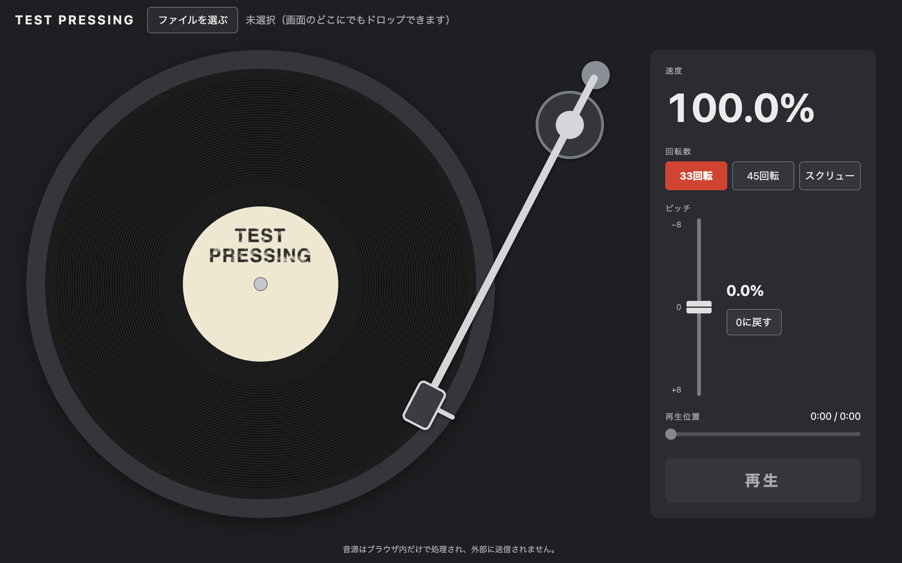

# LOCAL SPIN

手元の音源ファイルを、ピッチコントロール付きのターンテーブルのように、回転数とピッチを切り替えて再生する Web アプリです。

**公開ページ：** https://odditymana.github.io/local-spin/



## 作った理由

普段はレコードで DJ をしています。Bandcamp で買ったデータ音源も、Technics のターンテーブルみたいにピッチを上げ下げして聴けないかな、と思ったのがきっかけです。

- ピッチを上げ下げしたときに曲の雰囲気がどう変わるか、イメージだけでも聴いてみたい
- レコードは同じサイズの盤（12インチ、10インチ、7インチ）でも、33回転のものと45回転のものがあるので、両方の速さで聴き比べたい
- 45回転の盤を33回転で回すスクリュー（遅回し）は、実際の盤でうまくいくかは微妙。それでも「スクリューネタとして使えるか」を確かめられる再生環境がほしい。さらにそこから ±8% で速さを詰められるようにしたい

そんな「DJ をしていて欲しかったもの」を形にしたアプリです。

## 主な機能

- **回転数の切り替え**：33回転／45回転／スクリュー（45回転の盤を33回転で回した速さ、約0.74倍）
- **ピッチコントロール**：±8％、0.1％刻みの縦フェーダー（Technics と同じく上が −、下が ＋）
- **レコードと同じ音の変わり方**：速度を変えると、音の高さも一緒に変わる
- **現在の速度を％で表示**
- **回転するレコード**：再生速度に合わせて回る
- **トーンアーム**：再生位置に合わせて、外側から内側へ動く
- **シークバー**：経過時間／曲の長さの表示と、再生位置の移動
- **ニードルドロップ**：レコードの溝をクリックすると、その位置から再生する
- **AIFF 対応**：Chrome・Firefox では再生できない AIFF / AIFF-C（sowt）を、ブラウザ内で WAV に変換して再生する

## 使い方

1. 「ファイルを選ぶ」を押すか、音源ファイルを画面のどこかにドロップする
2. 「再生」を押す
3. 回転数・ピッチ・再生位置を好きに変える

### キーボード操作

すべての操作をキーボードで行えます。

| 部品 | キー | 動き |
|---|---|---|
| 全体 | Tab / Shift + Tab | 部品を移動する |
| 回転数 | ← → ↑ ↓ | 33／45／スクリューを切り替える |
| ピッチ | ↓ / ↑ | ＋0.1％ / −0.1％（つまみが下 / 上へ動く） |
| ピッチ | PageDown / PageUp | ＋1％ / −1％ |
| ピッチ | End / Home | ＋8％ / −8％ |
| 再生位置 | ← → | 1秒ずつ戻す / 進める |
| 再生位置 | Home / End | 曲の始め / 終わり |

## プライバシー

- 音源は**ブラウザ内だけで処理**し、外部には一切送信しません（アップロードはしていません）。
- 外部サイトの音源を読み込んだり、抜き出したりする機能はありません。

## 対応形式

| 形式 | 対応 |
|---|---|
| MP3・WAV・FLAC・AAC（.m4a）・Ogg | ブラウザがそのまま再生 |
| AIFF・AIFF-C（NONE / sowt） | ブラウザ内で WAV に変換して再生（8〜32bit） |
| ALAC（.m4a） | Safari のみ。ほかのブラウザでは案内メッセージを表示 |

どの形式を再生できるかは、ブラウザによって異なります。

## 工夫した点

### 速度と音の高さを一緒に変える

audio 要素の `playbackRate`（再生速度の倍率）に「基準速度 ×（1 ＋ ピッチ ÷ 100）」を入れています。ブラウザは標準では、速度を変えても音の高さを保とうとします。そこで `preservesPitch = false` にして、レコードと同じように「速いほど高い音」になるようにしました。古い Safari・Firefox 向けの `webkitPreservesPitch`・`mozPreservesPitch` もあわせて設定しています。

### 再生中に速度を変えても、レコードの角度が飛ばない

最初は CSS アニメーションの `animation-duration` を速度に合わせて変える案でした。ただ、この方法では速度を変えた瞬間に角度が計算し直され、レコードがワープしてしまいます。そこで `requestAnimationFrame` を使い、毎フレーム「経過時間 × 回転の速さ」を今の角度に足す形にしました。回転の速さは毎回 `playbackRate` から読むので、速度との連動に追加のコードは要りません。

### AIFF をブラウザ内で WAV に変換する

AIFF は「チャンク」という箱が並んだ形式です。COMM（音の形式）と SSND（音のデータ）を読み、WAV のヘッダを付けて作り直しています。

- AIFF は大きい桁が先（ビッグエンディアン）、WAV は小さい桁が先（リトルエンディアン）なので、1サンプルごとにバイトの順番を入れ替えています。
- サンプルレートは 80bit の拡張浮動小数点数で保存されています。JavaScript には 80bit の数値を直接読む機能がないので、符号・指数・仮数に分けて読み、仕様の式で計算しています。
- 変換は Node.js のテストで確かめています。テストの中でサイン波から「AIFF」と「正解の WAV」を組み立て、1バイトも違わないことを確認しています。

### トーンアームとニードルドロップ

針先がレコードの中心から 44（一番外側の溝）と 22（一番内側の溝）の距離に来るアームの角度を計算しました（座標は台座の直径を 100 とした値）。その2つの角度の間を、再生の進み具合（再生位置 ÷ 曲の長さ）で比例させています。比例させた場合の針先の位置のずれは、台座の直径の 0.1％以下です。

ニードルドロップはその逆の計算です。クリックした位置の中心からの距離を、進み具合に変えています。中心は、回転していない台座の位置から求めています。回転している要素の四角い範囲は、角度によって大きさが変わってしまうためです。

### アクセシビリティ

- すべての操作をキーボードで行えます。ボタン型の回転数切り替えも、中身はラジオボタンです。
- ファイル選択の input は `display: none` ではなく見た目だけ隠し、フォーカスが来たときは label 側に枠を表示しています。
- 縦フェーダーは、キーとつまみの動く向きがブラウザによって違うことがあります。そこで、キー操作を自分で処理して、どのブラウザでも同じ動きにそろえました。
- スクリーンリーダーで速度が二重に読み上げられないよう、スライダーの読み上げ値と、回転数を切り替えたときだけ使う読み上げ用の欄を分けています。
- `prefers-reduced-motion`（OS の「動きを減らす」設定）が有効なときは、レコードの回転を止めます。
- 文字と背景のコントラストは WCAG AA の基準（4.5:1 以上）を満たしています。ボタンの枠線などの部品も、基準の 3:1 以上にしています。

## 開発について

このアプリは Claude Code を使って開発しました。仕組みは、自分で理解して説明できる範囲のものだけを採用しています。

HTML・CSS・JavaScript のみで作っていて、フレームワークやライブラリは使っていません。

## ファイル構成

```
local-spin/
├── index.html            画面の骨組み
├── css/
│   └── style.css         見た目（レイアウト・レコード・操作パネル）
├── js/
│   ├── aiff-to-wav.js    AIFF → WAV 変換
│   └── main.js           読み込み・再生・速度・回転・再生位置
├── tests/
│   └── aiff-to-wav.test.js   AIFF 変換のテスト
├── docs/
│   └── checklist.md      ブラウザごとの確認項目
├── LICENSE
└── README.md
```

## 手元で動かす

`index.html` をブラウザで開くだけで動きます（サーバーは不要です）。

## テスト

Node.js 18 以降で、プロジェクトのフォルダから実行します。

```bash
node --test
```

テスト用の音はテストの中で生成するので、音源ファイルは必要ありません。

ブラウザでの確認項目は [docs/checklist.md](docs/checklist.md) にまとめています。

## ライセンス

[MIT License](LICENSE)
